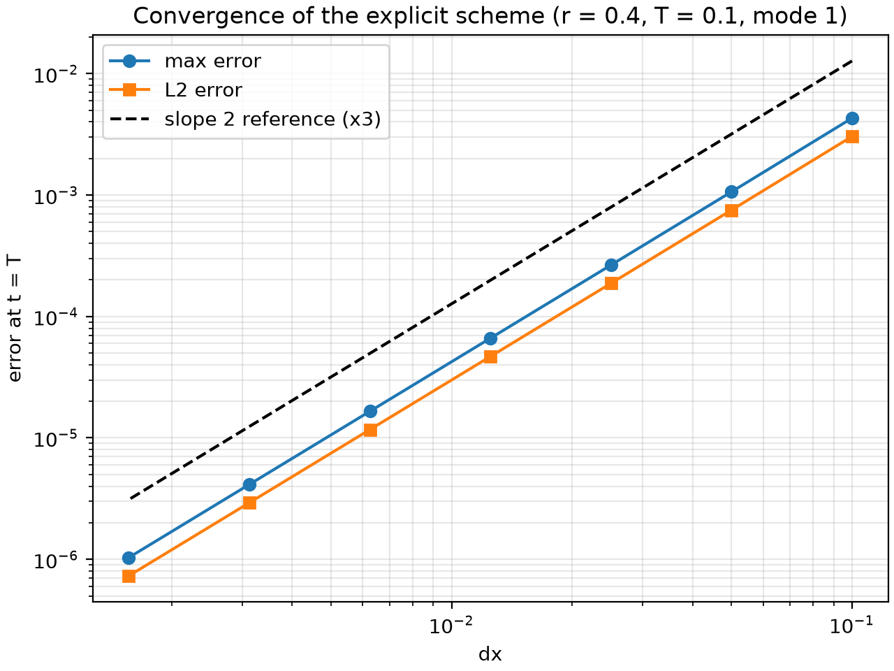
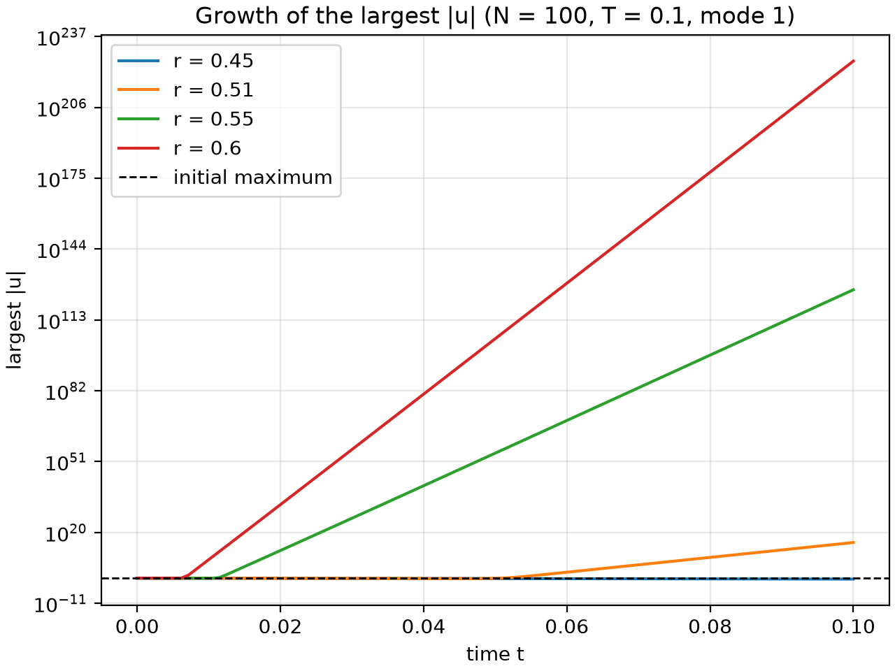

# heat_eqn
A program that approximates the solution to the 1D heat equation

    u_t = alpha * u_xx,   0 < x < L

on a rod with both ends held at 0. The initial state is a sine mode, `u(x, 0) = sin(mode * pi * x / L)`, and the solution is stepped forward with the explicit FTCS (forward-time, centred-space) scheme. Each snapshot is written alongside the exact solution, `u(x, t) = exp(-alpha * (mode * pi / L)^2 * t) * sin(mode * pi * x / L)`, so the error can be read straight from the output.

# Instructions

## Requirements
 - C++17 compiler
 - CMake 3.25 or newer
 - First configure downloads Catch2 so internet is needed
 - Python 3 with `numpy` and `matplotlib` (only for the scripts in `scripts/`); `pip install -r requirements.txt`

## Build debug
```bash
cmake --preset debug
cmake --build --preset debug
ctest --preset debug
./build/debug/Main
```

## Build release
```bash
cmake --preset release
cmake --build --preset release
ctest --preset release
./build/release/Main
```

## Debug vs Release
Debug is for development (warnings are errors, AddressSanitizer is on), release is for real, optimised runs.

## Running
`Main` runs one simulation and writes a CSV. Every flag is optional; anything left out keeps its default. Run it from the project root, because the default output path is relative.

```bash
./build/release/Main --n-intervals 50 --T 0.05 --mode 2 --snapshots 4 --output results/mode2.csv
```

| Flag | Meaning | Default |
|---|---|---|
| `--n-intervals <int>` | number of intervals along the rod (max 10,000,000) | 100 |
| `--length <double>` | rod length `L` | 1.0 |
| `--alpha <double>` | diffusivity | 1.0 |
| `--T <double>` | target time | 0.1 |
| `--r-req <double>` | requested `r = alpha * dt / dx^2` | 0.4 |
| `--mode <int>` | sine mode of the initial state (not 0) | 1 |
| `--snapshots <int>` | snapshots written after the initial state | 5 |
| `--output <path>` | output CSV path | `results/output.csv` |
| `--help`, `-h` | print usage | |

Values may be given as `--flag value` or `--flag=value`.

The number of time steps `n` is `ceil(T / dt_req)`, where `dt_req = r_req * dx^2 / alpha`. The step is then shrunk to `dt = T / n`, so the run ends exactly at `T` and the `r` actually used can be a little below `r_req`.

The run writes to `<output>.tmp` and renames it over the target only on success, so a failed run never overwrites an existing result.

### Warnings
Warnings are printed to stderr and do not stop the run:
 - `r` above 0.5 (the scheme is unstable)
 - mode too high for the number of intervals (`|mode| * 10 > n_intervals`)
 - the state decays almost to zero by `T`, so the error margin may be misleading
 - the initial function is not close to 0 at the left or right end

### Output format
CSV with the header `t,x,u_numeric,u_exact`. The first block is the initial state at `t = 0`, followed by one block per snapshot. Each block has one row per grid point (`n_intervals + 1` rows). Values are written with enough digits to round-trip exactly.

## Plotting
```bash
python3 scripts/plot.py [path/to/output.csv] [-o path/to/figure.png] [--show]
```
The CSV path defaults to `results/output.csv`. The figure is saved next to the CSV with a `.png` extension unless `-o/--output` is given, so scratch plots stay beside their data. For figures you want to keep in git, write them to a tracked folder, for example `-o docs/figures/default_run.png`. The window only opens with `--show`. A CSV with the wrong header, a truncated file (fewer than two snapshot blocks, or cut part-way through a block) or non-finite values (a diverged run, so check `r`) is rejected with a message and a non-zero exit code rather than a traceback or a misleading plot.

The top panel shows the exact solution (lines) with the numeric solution (markers); the bottom panel shows numeric minus exact, with the largest absolute error in its title. Generated CSVs and PNGs in `results/` are git-ignored.

The plot script has its own tests: `python3 -m unittest tests.test_plot` from the project root.

## Convergence
Fixed `r = 0.4`, `T = 0.1`, `L = 1`, `alpha = 1`, mode 1, halving `dx` each row. With these settings `n = N^2 / 4` is a whole number, so the step is exactly `r_req` and `r` stays at 0.4 for every row. Errors are measured at `t = T` (the max error is also the largest over all snapshots, since the error grows with time). The max error is the largest `|numeric - exact|` over the grid; the L2 error is `sqrt(dx * sum(d^2))`. Each order is `log(err_prev / err) / log(dx_prev / dx)`.

| N | dx | time steps | max error | max-error order | L2 error | L2 order |
|---|---|---|---|---|---|---|
| 10 | 0.1 | 25 | 4.2941e-03 | - | 3.0364e-03 | - |
| 20 | 0.05 | 100 | 1.0625e-03 | 2.01 | 7.5131e-04 | 2.01 |
| 40 | 0.025 | 400 | 2.6495e-04 | 2.00 | 1.8735e-04 | 2.00 |
| 80 | 0.0125 | 1,600 | 6.6195e-05 | 2.00 | 4.6807e-05 | 2.00 |
| 160 | 0.00625 | 6,400 | 1.6546e-05 | 2.00 | 1.1700e-05 | 2.00 |
| 320 | 0.003125 | 25,600 | 4.1364e-06 | 2.00 | 2.9249e-06 | 2.00 |
| 640 | 0.001563 | 102,400 | 1.0341e-06 | 2.00 | 7.3121e-07 | 2.00 |



The error falls by a factor of 4 each time the grid is halved, which is second-order convergence in `dx` (the points run parallel to the dashed slope-2 reference line, which is shifted up by a factor of 3 so it does not hide the data). Because `r` is fixed, `dt = r dx^2 / alpha` shrinks with `dx^2` as well, so this is the combined space and time error, not the spatial error alone. The default run (`N = 100`, `n = 2500`) has a max error of 4.236e-5, which sits between the `N = 80` and `N = 160` rows as expected.

To reproduce the table and figure with one command (build the release binary first, run from the project root):

```bash
python3 scripts/convergence.py
```

It runs `Main` for each `N` with one snapshot, writes `results/convN.csv`, reads them with the same loader as `plot.py`, and writes `docs/convergence_table.md` and `docs/figures/convergence.png`. It stops with a message and a non-zero exit code if `Main` fails or prints anything on stderr (for example an unstable `r`), if a CSV is malformed, or if the last block is not at `t = T`. Options (all optional): `--exe`, `--ns`, `--length`, `--alpha`, `--mode`, `--T`, `--r-req`, `--csv-dir`, `--figure`, `--table`.

The script's calculations are tested with `python3 -m unittest tests.test_convergence_script`. The N = 20 row (max error 1.0625e-3, L2 7.51e-4) is cross-checked against the C++ test in `tests/test_convergence.cpp`, and that Python test is skipped if `build/release/Main` is absent.

## Stability
The explicit scheme is stable only for `r <= 0.5`. `scripts/instability.py` runs `Main` at several requested values of `r` (default 0.45, 0.51, 0.55, 0.6; `N = 100`, `T = 0.1`, mode 1, 100 snapshots) and plots the largest `|u|` against time on a log axis. Build the release binary first, then run from the project root:

```bash
python3 scripts/instability.py
```



The script stops with a message and a non-zero exit code if the solver output does not match the expected stability: a stable `r` must print nothing on stderr and end with a smaller peak than it started with, and an unstable `r` must print a `Warning` and end more than 10 times above its start. Options (all optional): `--exe`, `--rs`, `--n-intervals`, `--snapshots`, `--length`, `--alpha`, `--mode`, `--T`, `--csv-dir`, `--figure`. Its calculations are tested with `python3 -m unittest tests.test_instability_script`.

The `r` actually used is slightly below the requested one, because the step is shrunk so the run ends exactly at `T`. A request of 0.51 runs at about 0.5099, which is still unstable.

### Why it goes unstable
Any profile can be split into sine waves of different wavelengths, and the explicit scheme multiplies each wave by a fixed growth factor `g` at every step. A wave with `|g| < 1` shrinks and one with `|g| > 1` grows exponentially. The shortest wave the grid can hold, a sawtooth that alternates sign at every grid point, has `g = 1 - 4r`. Smoother waves have `g` closer to 1, so the sawtooth is the first to fail. It satisfies `|g| <= 1` exactly when `r <= 1/2`, which is the stability limit.

The initial sine is smooth and contains almost no sawtooth. The sawtooth is seeded only by rounding error, around `1e-16` for doubles. The plotted largest `|u|` is whichever part is bigger, so each unstable curve shows the smooth part decaying (from 1 towards about 0.37 at `T`), then a sharp turn upward when the growing sawtooth overtakes it. On the log axis the growing part is a straight line.

### When the curve turns up
The sawtooth grows by `|1 - 4r|` per step from about `1e-16`, so it reaches size 1 after `k = ln(1e16) / ln|1 - 4r|` steps, at time `t = k * dt`. With `N = 100`, `dt = r_used * dx^2`. Worked out by hand before the run, from handwritten notes, using the `r` actually used:

| Requested r | r used | Steps to turn up | Turn-up time t |
|---|---|---|---|
| 0.51 | 0.509944 | 944.5 | 0.048166 |
| 0.55 | 0.549753 | 203.0 | 0.011159 |
| 0.6 | 0.599880 | 109.6 | 0.006575 |

These match the graph to within about 6%. In the CSVs the 0.51 curve falls to about 0.67 by t = 0.041 and is back at 1 by t = 0.051. The 0.55 curve is still near 0.9 at t = 0.0104 and enormous by t = 0.0208. The 0.6 curve is already about 4e8 by t = 0.0102. The turn-up moves earlier as `r` increases because `|g|` is larger.

### Size of the seed
The turn-up times above assume a seed of `1e-16`, the machine epsilon for doubles. That was an initial guess made before the runs. After the runs, the seed was fitted by working backwards from the measured final peaks, `seed = peak at T / |g|^n` with the `r` actually used. This gives about 1e-17.6 at r = 0.51, 1e-17.2 at r = 0.55 and 1e-17.1 at r = 0.6, so the effective seed is about `1e-17`, not `1e-16`. Because `1e-17` was fitted to these same runs, it reproducing the final peaks (exponents of about 16.2, 126.4 and 226.3 against measured 15.6, 126.2 and 226.2) is by construction and is not independent evidence. The fit uses only three points, so `1e-17` is an order-of-magnitude estimate. A likely reason for a seed below machine epsilon is that rounding error is spread across all the grid-point modes, so each mode, the sawtooth included, receives roughly `1e-16 / sqrt(N)`, which is about 1e-17 for `N = 100`; this explanation has not been tested.

A seed of 1e-17 instead of 1e-16 delays every turn-up by a factor of 17/16, about 6%, so the table above is about 6% early. This agrees with the 0.51 curve, which is back at about 1 near t = 0.051 (1.03 in the CSV) rather than 0.048.

### The stable case
For `r = 0.45`, `g = 1 - 4r = -0.8`, so each step multiplies the sawtooth by 0.8 in size. The same formula, `ln(1e-16) / ln(0.8)`, now gives the number of steps a sawtooth of size 1 needs to shrink to rounding level: about 165 steps, or `t` of about 0.0074. This is the time for the fastest-varying part of the solution to disappear completely, which is about 7% of the run.

The sawtooth has a time constant of `dt / |ln 0.8|`, about 2e-4, while the smooth sine decays with a time constant of about `1/pi^2`, roughly 0.1. The sawtooth therefore dies about 500 times faster than the smooth part. This is why diffusion smooths data and why a stable run looks clean: rounding errors in the high modes are wiped out within a few steps of appearing. The stable peak at `T` follows the exact solution, `exp(-pi^2 * alpha * T / L^2) = 0.3727` for `L = 1`, `alpha = 1`, `T = 0.1`, and the r = 0.45 run ends at 0.372656, in agreement with it.


## Project layout
```
src/
  core/       Grid and initial-state construction
  solver/     FTCS time step, step-parameter calculation, step loop
  verifier/   Sine initial function and exact solution
  writer/     CSV output
  driver/     run_simulation (validation, snapshots, warnings) and the CLI parser
  main.cpp    Command-line entry point
tests/        Catch2 unit tests (C++, one file per module, plus test_convergence.cpp)
              and Python tests (test_plot.py, test_convergence_script.py,
              test_instability_script.py)
scripts/      plot.py (plot one run), convergence.py (grid-refinement study)
              and instability.py (stable vs unstable r)
results/      Default output location for CSVs (contents are git-ignored)
docs/         Kept in git: convergence_table.md and figures (docs/figures/)
```
The `src` modules other than `main.cpp` are built into the `heat_solver` library, which both `Main` and `unit_tests` link against.
